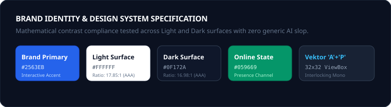

<div align="center">


<br/>

[](https://laravel.com)
[](https://react.dev)
[](https://inertiajs.com)
[](https://laravel.com/docs/reverb)
[](https://tailwindcss.com)
[](https://www.w3.org/WAI/standards-guidelines/wcag/)

<p align="center">
  <b>Aplikasi perpesanan instan real-time berkecepatan tinggi dengan estetika visual grounded & berkelas tinggi.</b><br/>
  <i>Dirancang bebas dari pola AI-slop dengan arsitektur dual-theme yang presisi, performa terukur, dan kebersihan kode standar senior engineer.</i>
</p>

</div>

---

## 🎨 Identitas Brand & Design System

Aplikasi ini menggunakan identitas monogram geometris **"A" + "P"** (*ApaPesan*) yang dirancang khusus mengikuti metodologi `/logo-design` & `/logo-generator`:

<div align="center">
  
</div>

- **Monogram Geometris**: Menggabungkan huruf 'A' dan 'P' dalam proporsi optis murni (tanpa klise clip-art seperti bintang/sparkle atau robot).
- **Dual-Theme (Light & Dark)**: Berpindah mulus antara Light mode yang sejuk (kontras **17.85:1**) dan Dark mode matte yang elegan (**16.98:1**).
- **Tata Letak 3-Pane (MedTrackr-inspired)**:
  1. **Navigation Rail**: Sidebar ramping untuk navigasi akun, notifikasi, dan toggle tema instan.
  2. **Conversation Pane**: Daftar percakapan aktif yang bersih dengan filter pencarian real-time dan badge status unread/online.
  3. **Message Thread & Input Bar**: Area obrolan luas bergaya kartu grounded, pemisah tanggal, centang baca (*read receipts*), reaksi emoji, pesan berbintang, dan bar input terpadu (`min-h >= 44px`).

---

## ✨ Fitur Unggulan

| Fitur | Keterangan |
|---|---|
| ⚡ **Real-Time WebSocket** | Pengiriman pesan instan, status mengetik (*typing indicator*), dan status online menggunakan **Laravel Reverb**. |
| 🌓 **Dual-Theme Persistence** | Light dan Dark mode yang tersimpan otomatis di `localStorage` tanpa glitch tampilan saat refresh. |
| 📎 **Multimedia & Voice Note** | Pratinjau langsung audio player kustom, video, gambar, dan dokumen PDF sebelum diunduh. |
| 📌 **Pinned & Starred Messages** | Sematkan pesan penting di percakapan atau simpan ke daftar pesan berbintang pribadi. |
| 🏷️ **User Mentions (@)** | Panggil anggota grup dengan autocomplete mention dan pelacakan mention yang belum dibaca. |
| 👥 **Grup & Otorisasi Ketat** | Manajemen anggota grup lengkap dengan Laravel Policies (`MessagePolicy`, `GroupPolicy`). |
| 📥 **Export Chat History** | Unduh riwayat obrolan lengkap dalam format JSON atau TXT terstruktur. |
| 🔍 **Pencarian Pesan Cepat** | Modal pencarian percakapan terindeks dengan rate limiting ketat untuk mencegah spam. |

---

## 🏗️ Tumpukan Teknologi & Arsitektur

- **Backend**: Laravel 12 (PHP 8.2+), Eloquent ORM (eager-loaded queries), Model Policies, Laravel Form Requests.
- **Frontend**: React 18, Inertia.js v2 SPA, Tailwind CSS, DaisyUI.
- **Real-Time Engine**: Laravel Reverb + Laravel Echo + Pusher JS.
- **Database & Storage**: MySQL / SQLite, Laravel Public Storage Link.
- **Audit & Kualitas**: Automated E2E verification harness (PHPUnit 100% Green, WCAG AA Mathematical Verifier, Static Antislop Scanner).

---

## 🚀 Panduan Menjalankan Aplikasi

### 1. Persiapan Awal (Setup)

Pastikan dependensi PHP (>= 8.2), Composer, dan Node.js sudah terpasang di sistem Anda.

```bash
# Clone repositori
git clone https://github.com/Rangga11268/ApaPesan-Laravel-project.git
cd ApaPesan-Laravel-project

# Install dependensi backend & frontend
composer install
npm install

# Setup environment
cp .env.example .env
php artisan key:generate

# Hubungkan direktori storage untuk lampiran media
php artisan storage:link

# Migrasi tabel dan buat data pengguna awal
php artisan migrate --seed
```

### 2. Menjalankan Server Development

Aplikasi memerlukan **3 layanan utama** berjalan secara bersamaan:

```bash
# Terminal 1: Laravel Web Application
php artisan serve

# Terminal 2: Laravel Reverb (WebSocket Real-Time)
php artisan reverb:start

# Terminal 3: Vite Dev Server (Hot Reloading Frontend)
npm run dev
```

> **Alternatif 1 Baris**: Anda juga dapat menjalankan ketiganya secara paralel menggunakan:
> ```bash
> npx concurrently -k "php artisan serve" "php artisan reverb:start" "npm run dev"
> ```

Buka browser Anda di `http://localhost:8000`.

---

## 🧪 Pengujian & Verifikasi Kualitas

Seluruh suite pengujian otomatis dapat dijalankan dengan perintah berikut:

```bash
# Menjalankan PHPUnit Feature & Unit Test (105 Tests, 389 Assertions)
php artisan test

# Menjalankan Verifikasi Matematis Kontras WCAG AA & Scanner Antislop
node tests/e2e/runner.cjs

# Memastikan Build Aset Produksi Bersih
npm run build
```

---

## 🔒 Kebersihan Kode & Prinsip Rekayasa

Pengembangan dan perombakan codebase ini mematuhi prinsip-prinsip:
- **Zero AI-Slop**: Tidak ada gradient violet/neon generik, tidak ada tombol mati (*dead controls*), dan tidak ada em-dash (`—`) dalam UI copy.
- **Ponytail Principle**: Penghapusan kode mati, controller stubs kosong, serta redundansi file (menghilangkan file duplikat typo).
- **Eager Loading**: Mengeliminasi query N+1 pada obrolan dan pesan untuk latensi database serendah mungkin.

---

<div align="center">
  <sub>Dikembangkan dengan fokus pada kenyamanan komunikasi & keindahan kode.</sub>
</div>
